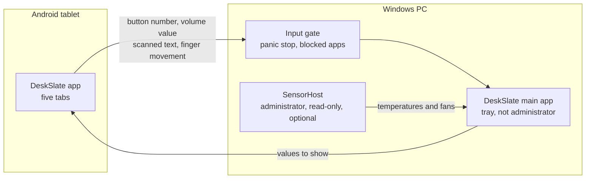
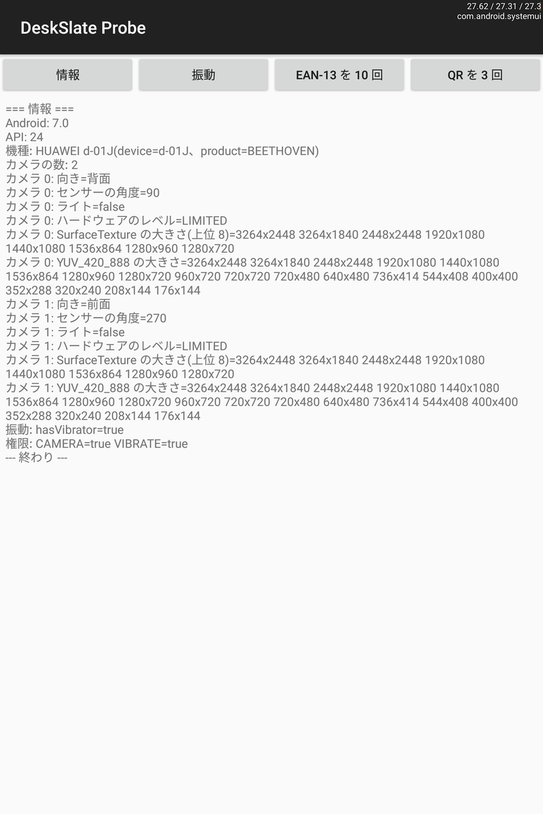

# DeskSlate

Turns an Android tablet on your desk into a side panel for a Windows PC.

[日本語](README.md) | English

> **Work in progress. Only the measurement tools (probes) are usable now.**
> This repository contains tools that inspect the real PC and the real tablet to settle the design (a PC side and an Android side). The side-panel app itself does not exist yet, on either side.

## Contents

- [What it will be](#what-it-will-be)
- [Status](#status)
- [Screenshot](#screenshot)
- [Getting started](#getting-started)
- [Using the probes](#using-the-probes)
- [Building from source](#building-from-source)
- [Safety and privacy](#safety-and-privacy)
- [Manual (PDF)](#manual-pdf)
- [License](#license)

## What it will be

One Android app (Kotlin) and one Windows tray app (C# / .NET 10 / WPF), with five tabs:

| Tab | What it does |
|---|---|
| Panel | Buttons that open apps, send key combinations, control media, or run scripts you registered and approved on the PC |
| Mixer | Per-app volume and mute on faders |
| Dashboard | PC status, service up/down checks, recent earthquake information |
| Scan | Read a barcode and type it into the PC, or take a photo and send it to the PC |
| Pad | Touchpad and numeric keypad |



Design rules:

- The tablet only sends things like "button N was pressed". What to open and which keys to send are looked up from the PC-side settings only.
- The main app never runs as administrator. Temperatures and fan speeds are read by a separate read-only process (SensorHost).
- The PC can stop all input from the tablet at any time (panic stop).

## Status

The project is in Phase 0: building the probes and inspecting the real PC and tablet.

| Phase 0 item | Built | Checked on real hardware |
|---|---|---|
| PC probes (`audio` / `metrics` / `foreground` / `keys` / `pipe`) | Done | Not yet |
| PC `DeskSlate.SensorHost --probe` (list of temperature and fan sensors) | Done | Not yet |
| Android probe: device info, camera list, vibration | Done | Done (dtab d-01J) |
| Android probe: connecting to the camera and receiving frames | Done | Done (dtab d-01J) |
| Android probe: real reads of EAN-13 x10 and QR x3 | Done | Not yet |

| Phase | Content | State |
|---|---|---|
| Phase 1 | Foundation (connection, pairing, panic stop, settings) | Part of `DeskSlate.Core` only (input gate, settings load/save, message types). Connection and UI not started |
| Phase 2–8 | The five features and release work | Not started |

## Screenshot

The Android probe after tapping 「情報」 (Info), on a dtab d-01J.



The probe's screens and output are in Japanese only.

## Getting started

The v0.0.1 pre-release on [Releases](https://github.com/takosasi-dev/desk-slate/releases) has two files:

| File | Content |
|---|---|
| `DeskSlate-Probe-v0.0.1-win-x64.zip` | PC-side Probe and SensorHost. The .NET 10 runtime is included, so you do not need to install .NET (Windows 11, x64) |
| `DeskSlate-Probe-v0.0.1-android.apk` | Android-side probe (Android 7.0 or later) |

### PC side

1. Download `DeskSlate-Probe-v0.0.1-win-x64.zip`, right-click it and choose "Extract All".
2. Open the `DeskSlate-Probe-v0.0.1-win-x64` folder, right-click an empty area and choose "Open in Terminal" to get a PowerShell window there.
3. Run this to see the list of commands:

```powershell
.\DeskSlate.Probe.exe
```

Nothing is installed. Deleting the folder removes it.

### Android side

Either:

- On the tablet: copy `DeskSlate-Probe-v0.0.1-android.apk` to the tablet, open it from a file manager, allow installing from unknown sources, and install. Where that setting lives depends on the Android version.
- From the PC (with USB debugging enabled and `adb` available):

```powershell
adb install -r DeskSlate-Probe-v0.0.1-android.apk
```

Open "DeskSlate Probe" from the home screen; the device info appears.

> The APK is a **temporary build signed with a debug key**. Builds signed with the real key later will not install over it; uninstall this one first when that happens.

## Using the probes

### PC side (in PowerShell, in the extracted folder)

Marks: **[Admin]** needs an elevated PowerShell. **[Acts on PC]** really changes volume or types keys on your PC; these ask for `y` before doing anything.

| Command | What it does | Duration |
|---|---|---|
| `.\DeskSlate.Probe.exe audio` | Lists the default playback device and per-app volume and mute | Instant |
| `.\DeskSlate.Probe.exe audio --set <exe> <0-100>` **[Acts on PC]** | Changes that app's volume for 2 seconds, then restores it | About 2 s |
| `.\DeskSlate.Probe.exe metrics` | Prints CPU, memory, disk, network, battery and GPU values together with the API used for each | 5 s |
| `.\DeskSlate.Probe.exe foreground` | Prints the exe name each time the foreground window changes | 30 s |
| `.\DeskSlate.Probe.exe keys` **[Acts on PC]** | After 5 seconds, types `0123456789ABC-123` into the foreground window | About 5 s |
| `.\DeskSlate.Probe.exe pipe` | Creates a named pipe only you can read and passes one line through it | Instant |
| `.\DeskSlate.SensorHost.exe --probe` **[Admin]** | Lists hardware and sensors such as temperatures and fans (read-only) | A few seconds |

- `keys` really types. Open Notepad first, press `y`, then click Notepad within 5 seconds to bring it to the front.
- `SensorHost` is built to run as administrator, so a UAC prompt appears. Run it from an elevated PowerShell so you can read the output.

Example output of `audio` (names and numbers are made up):

```text
API: NAudio.Wasapi 3.3.0.0
既定の再生デバイス(Render / Multimedia): スピーカー (Example Audio)
全体(AudioEndpointVolume): MasterVolumeLevelScalar=0.40 Mute=False
セッション(AudioSessionManager.Sessions): 1 個
  [0] pid=1234 exe=example.exe system=False state=AudioSessionStateActive SimpleAudioVolume.Volume=1.00 Mute=False peak=0.12
audio: 一覧を出しました
```

### Android side

| Button | adb `action` | What it does |
|---|---|---|
| 情報 (Info) | `info` | Prints Android version, model, camera list, vibration support and permissions. Also runs at startup |
| 振動 (Vibrate) | `vibrate` | Vibrates for 0.2 seconds |
| EAN-13 を 10 回 (EAN-13 x10) | `ean` | Reads an EAN-13 (product barcode) 10 times with the back camera and prints each time, how many reads took 3 seconds or less, the median, and whether the target (8 or more within 3 seconds) is met |
| QR を 3 回 (QR x3) | `qr` | Reads a QR code 3 times with the back camera and prints each time, how many took 3 seconds or less, and the median |

Reading, from the buttons:

1. Tap 「EAN-13 を 10 回」. The first time, allow the camera permission.
2. The camera preview and a 「読む(1/10)」 (Read) button appear.
3. Tapping 「読む(n/10)」 starts the timer. Bring the barcode into the preview (horizontal or vertical both work). On a successful read the tablet vibrates and the button moves to the next attempt. If nothing is read in 10 seconds, that attempt fails.
4. After 10 attempts the result lines appear, ending with `--- 終わり ---`. Leaving the screen stops the run.

It can also be driven from adb. For `ean` and `qr`, the first attempt starts by itself as soon as the camera is ready, so hold the barcode in front of the back camera before running the command. From the second attempt on, tap 「読む(n/10)」 on the screen. Every line is also written to logcat with the tag `DeskSlateProbe`.

```powershell
adb shell am start -n io.github.takosasidev.deskslate.probe/.MainActivity --es action info
adb logcat -s DeskSlateProbe
```

Step-by-step instructions and how to read the results are in the [manual (PDF, Japanese)](#manual-pdf).

## Building from source

### PC side

Requirements: Windows 11 (x64), .NET 10 SDK.

```powershell
dotnet build pc\DeskSlate.sln -c Release
dotnet test pc\DeskSlate.sln -c Release
```

The executables end up in `pc\src\DeskSlate.Probe\bin\Release\net10.0-windows\win-x64\` and `pc\src\DeskSlate.SensorHost\bin\Release\net10.0-windows\win-x64\`.

### Android side

Requirements: JDK 17, Android SDK (compileSdk 35). Put the SDK location in `android\local.properties` (this file is not committed):

```properties
sdk.dir=<Android SDK folder, using \\ or / as separators>
```

```powershell
cd android
.\gradlew.bat assembleDebug
.\gradlew.bat test
```

The APK ends up in `android\probe\build\outputs\apk\debug\`.

## Safety and privacy

- **Nothing is saved or sent.** The PC Probe and SensorHost only print to the console; they write no files and open no network connections. The Android probe has only the camera (`CAMERA`) and vibration (`VIBRATE`) permissions, no internet permission, and saves nothing.
- **Do not paste the output in public places as is.** PC output contains names of running apps, the playback device name, drive sizes and hardware model names.
- **SensorHost runs as administrator.** It only reads temperatures and fan speeds and does not change hardware settings.
- **No driver is installed.** PawnIO, used to read some sensors, is something you install yourself if you want it. This software neither bundles nor installs it (SensorHost only reports whether it is installed).
- `keys` and `audio --set` really act on the PC. Both ask for `y` first, and `audio --set` restores the original volume after 2 seconds.

## Manual (PDF)

A Japanese manual covering installation, usage, reading the results, troubleshooting and removal will be attached to [Releases](https://github.com/takosasi-dev/desk-slate/releases) as `DeskSlate-Probe-manual-ja.pdf`. Its source is in [`docs/manual/`](docs/manual/).

## License

MIT ([LICENSE](LICENSE)). Licenses of the libraries used and of the .NET runtime bundled in the zip are listed in [THIRD-PARTY-NOTICES.md](THIRD-PARTY-NOTICES.md).
