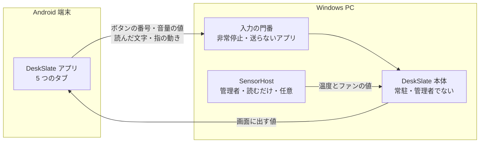
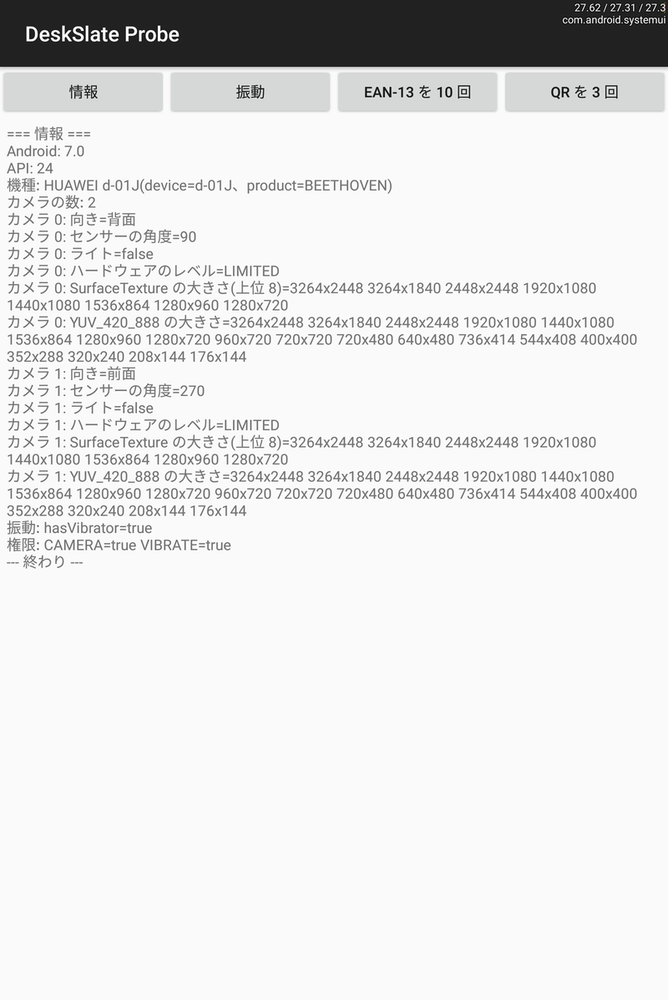

# DeskSlate

机の上の Android 端末を、Windows PC の「手元パネル」にするソフトです。

日本語 | [English](README.en.md)

> **開発中です。いま使えるのは測定用ツール(Probe)だけです。**
> このリポジトリにあるのは、設計を決めるために PC と端末の実物を調べる道具(PC 側と Android 側)です。手元パネルのアプリ本体は、PC 側も Android 側もまだありません。

## 目次

- [作ろうとしている物](#作ろうとしている物)
- [いまの状況](#いまの状況)
- [画面](#画面)
- [はじめ方](#はじめ方)
- [測定用ツールの使い方](#測定用ツールの使い方)
- [ソースからビルド](#ソースからビルド)
- [安全とプライバシー](#安全とプライバシー)
- [取扱説明書(PDF)](#取扱説明書pdf)
- [ライセンス](#ライセンス)

## 作ろうとしている物

端末側のアプリ 1 本(Kotlin)と、PC 側の常駐アプリ 1 本(C# / .NET 10 / WPF)で、次の 5 つをタブで切り替える予定です。

| タブ | できること |
|---|---|
| 操作パネル | ボタンでアプリを開く、キーを送る、メディアを操作する、PC で登録して承認したスクリプトを動かす |
| 音量ミキサー卓 | アプリごとの音量とミュートをフェーダーで動かす |
| ダッシュボード | PC の状態、サーバーの生死、直近の地震情報を出し続ける |
| 読み取り | バーコードを読んで PC に打ち込む、写真を撮って PC に送る |
| パッド | タッチパッドとテンキー |



設計で守ること:

- 端末が送るのは「押したボタンの番号」などだけです。何を開くか、どのキーを送るかは PC 側の設定からしか引きません。
- 本体は管理者で動かしません。温度とファンだけを、読むことしかできない別プロセス(SensorHost)に任せます。
- 端末からの操作は、PC 側の非常停止でいつでも止められます。

## いまの状況

いまは Phase 0(測定用ツールを作り、PC と端末の実物を調べる段階)です。

| Phase 0 の中身 | 作る | 実物での確認 |
|---|---|---|
| PC 側の Probe(`audio` / `metrics` / `foreground` / `keys` / `pipe`) | 済み | これから |
| PC 側の `DeskSlate.SensorHost --probe`(温度とファンのセンサーの一覧) | 済み | これから |
| Android 側の probe: 端末の情報とカメラの一覧、振動 | 済み | 済み(dtab d-01J) |
| Android 側の probe: カメラにつないで画像が届くか | 済み | 済み(dtab d-01J) |
| Android 側の probe: EAN-13 を 10 回・QR を 3 回の実読 | 済み | これから |

| 段階 | 中身 | 状態 |
|---|---|---|
| Phase 1 | 土台(接続、ペアリング、非常停止、設定) | `DeskSlate.Core` の一部(操作の門番、設定の読み書き、メッセージの型)と、PC 側の接続の部品 `DeskSlate.Link`(待ち受け、ペアリング、認証)を先に作った。確かめたのは単体テストだけで、端末側の接続と画面はこれから |
| Phase 2〜8 | 5 つの機能と仕上げ | これから |

## 画面

Android 側の probe で「情報」を押したところ(dtab d-01J)。



## はじめ方

[Releases](https://github.com/takosasi-dev/desk-slate/releases) の v0.0.1(プレリリース)に、次の 2 つを置いています。

| ファイル | 中身 |
|---|---|
| `DeskSlate-Probe-v0.0.1-win-x64.zip` | PC 側の Probe と SensorHost。.NET 10 のランタイムごと入っているので、.NET を入れなくても動きます(Windows 11、x64) |
| `DeskSlate-Probe-v0.0.1-android.apk` | Android 側の probe(Android 7.0 以降) |

### PC 側

1. `DeskSlate-Probe-v0.0.1-win-x64.zip` をダウンロードし、右クリック →「すべて展開」で展開します。
2. できた `DeskSlate-Probe-v0.0.1-win-x64` フォルダを開き、何も無い所を右クリック →「ターミナルで開く」で PowerShell を開きます。
3. 次を打つと、使い方の一覧が出ます。

```powershell
.\DeskSlate.Probe.exe
```

インストールはしません。フォルダを消せば片付きます。

### Android 側

次のどちらかで入れます。

- 端末で入れる: `DeskSlate-Probe-v0.0.1-android.apk` を端末にコピーしてファイルのアプリから開き、「提供元不明のアプリ」を許可してインストールします(許可の場所は Android の版によって違います)。
- PC から入れる(USB デバッグを有効にした端末と `adb` がある場合):

```powershell
adb install -r DeskSlate-Probe-v0.0.1-android.apk
```

ホーム画面の「DeskSlate Probe」を開くと、端末の情報が出ます。

> APK は**デバッグ用の鍵で署名した仮の物**です。正式な鍵に変えた後の版は上書きで入らないので、そのときはこの版を消してから入れ直してください。

## 測定用ツールの使い方

### PC 側(展開したフォルダの PowerShell で)

印の意味: **[管理者]** は管理者の PowerShell が要る物、**[PC を操作]** は PC の音量やキー入力を実際に動かす物です(**[PC を操作]** の物は、動かす前に `y` の確認があります)。

| コマンド | やること | 時間 |
|---|---|---|
| `.\DeskSlate.Probe.exe audio` | 既定の再生デバイスと、アプリごとの音量・ミュートの一覧を出す | すぐ |
| `.\DeskSlate.Probe.exe audio --set <exe名> <0-100>` **[PC を操作]** | その exe の音量を 2 秒だけ変えて元に戻す | 約 2 秒 |
| `.\DeskSlate.Probe.exe metrics` | CPU・メモリ・ディスク・ネットワーク・バッテリー・GPU の値を、試した API の名前と一緒に出す | 5 秒 |
| `.\DeskSlate.Probe.exe foreground` | 前面のウィンドウが切り替わるたびに、exe 名を出す | 30 秒 |
| `.\DeskSlate.Probe.exe keys` **[PC を操作]** | 5 秒後に、前面のウィンドウへ `0123456789ABC-123` を打つ | 約 5 秒 |
| `.\DeskSlate.Probe.exe pipe` | 自分だけが読める名前付きパイプを作り、1 行やり取りできるかを試す | すぐ |
| `.\DeskSlate.SensorHost.exe --probe` **[管理者]** | ハードウェアと、温度・ファンなどのセンサーの一覧を出す(読むだけ) | 数秒 |

- `keys` は本当にキーを打ちます。先にメモ帳を開き、`y` を押してから 5 秒以内にメモ帳をクリックして前面にしてください。
- `SensorHost` は管理者で動くように作ってあり、起動すると UAC の確認が出ます。結果を読むために、管理者の PowerShell から動かしてください。

出力の例(`audio`。名前と数字は架空の例です):

```text
API: NAudio.Wasapi 3.3.0.0
既定の再生デバイス(Render / Multimedia): スピーカー (Example Audio)
全体(AudioEndpointVolume): MasterVolumeLevelScalar=0.40 Mute=False
セッション(AudioSessionManager.Sessions): 1 個
  [0] pid=1234 exe=example.exe system=False state=AudioSessionStateActive SimpleAudioVolume.Volume=1.00 Mute=False peak=0.12
audio: 一覧を出しました
```

### Android 側

| ボタン | adb の `action` | やること |
|---|---|---|
| 情報 | `info` | Android の版・機種・カメラの一覧・振動の可否・権限を出す。起動したときにも出す |
| 振動 | `vibrate` | 0.2 秒振動させる |
| EAN-13 を 10 回 | `ean` | 背面カメラで EAN-13(商品のバーコード)を 10 回読み、1 回ごとの時間、3 秒以内に読めた回数、時間の中央値、目安(3 秒以内に 8 回以上)を満たすかを出す |
| QR を 3 回 | `qr` | 背面カメラで QR を 3 回読み、1 回ごとの時間、3 秒以内に読めた回数、中央値を出す |

読み取りの流れ(ボタンから):

1. 「EAN-13 を 10 回」を押します。初めてのときはカメラの権限を聞かれるので許可します。
2. カメラの映像と「読む(1/10)」のボタンが出ます。
3. 「読む(n/10)」を押すと時間を測り始めます。バーコードを映像の中に入れてください(横向きでも縦向きでも読めます)。読めると振動して、次の回のボタンに変わります。10 秒で読めなければ、その回は失敗です。
4. 10 回終わると結果の行が出て、最後に `--- 終わり ---` が出ます。途中でほかの画面に移ると、そこで止まります。

adb から動かすこともできます。`ean` と `qr` は、カメラの準備ができた時点で 1 回目の計測が自動で始まるので、先にバーコードを背面カメラの前に構えてから実行してください。2 回目からは画面の「読む(n/10)」を押します。出した行は logcat のタグ `DeskSlateProbe` にも出ます。

```powershell
adb shell am start -n io.github.takosasidev.deskslate.probe/.MainActivity --es action info
adb logcat -s DeskSlateProbe
```

詳しい手順と結果の読み方は、[取扱説明書(PDF)](#取扱説明書pdf)にあります。

## ソースからビルド

### PC 側

要る物: Windows 11(x64)、.NET 10 SDK。

```powershell
dotnet build pc\DeskSlate.sln -c Release
dotnet test pc\DeskSlate.sln -c Release
```

実行ファイルは `pc\src\DeskSlate.Probe\bin\Release\net10.0-windows\win-x64\` と `pc\src\DeskSlate.SensorHost\bin\Release\net10.0-windows\win-x64\` にできます。

### Android 側

要る物: JDK 17、Android SDK(compileSdk 35)。`android\local.properties` に SDK の場所を書いておきます(このファイルはリポジトリに入れません)。

```properties
sdk.dir=<Android SDK のフォルダ。区切りは \\ か />
```

```powershell
cd android
.\gradlew.bat assembleDebug
.\gradlew.bat test
```

APK は `android\probe\build\outputs\apk\debug\` にできます。

## 安全とプライバシー

- **保存しない・外へ通信しない。** PC 側の Probe と SensorHost は、結果を画面に出すだけで、ファイルに書かず、ネットワークにもつなぎません。Android 側の probe が持つ権限はカメラ(`CAMERA`)と振動(`VIBRATE`)だけで、インターネットの権限を持たず、何も保存しません。
- **出力をそのまま公開の場所に貼らない。** PC 側の出力には、動いているアプリの名前、再生デバイスの名前、ドライブの容量、ハードウェアの型番などが入ります。
- **SensorHost は管理者で動きます。** 温度とファンの値を読むだけで、ハードウェアの設定は変えません。
- **ドライバは入れません。** 一部のセンサーを読むのに使う PawnIO は、使う人が自分で入れる物です。このソフトは同梱も導入もしません(SensorHost は、入っているかどうかを出すだけです)。
- `keys` と `audio --set` は PC を実際に操作します。どちらも動かす前に `y` の確認があり、`audio --set` は 2 秒後に元の音量に戻します。

## 取扱説明書(PDF)

測定用ツールの入れ方・使い方・結果の読み方・困ったとき・片付けをまとめた日本語の取扱説明書を、[Releases](https://github.com/takosasi-dev/desk-slate/releases) に `DeskSlate-Probe-manual-ja.pdf` として置きます。説明書の元は [`docs/manual/`](docs/manual/) にあります。

## ライセンス

MIT([LICENSE](LICENSE))。使っているライブラリと、zip に同梱している .NET のランタイムのライセンスは [THIRD-PARTY-NOTICES.md](THIRD-PARTY-NOTICES.md) にあります。
